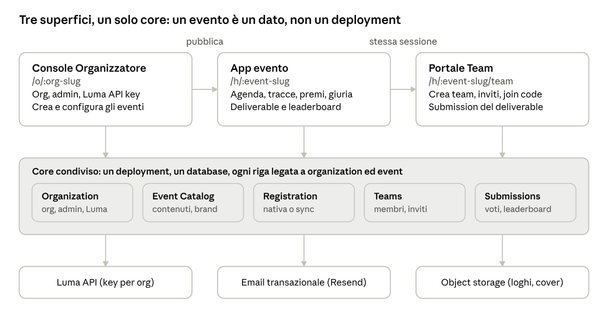

# Trascrizione — Hackathon Platform — PRD v0.1

## Provenienza

Questa pagina è una trascrizione leggibile della fonte. Non la sostituisce.

| Campo | Valore |
| --- | --- |
| Titolo nel documento (`dc:title`) | Hackathon Platform — PRD v0.1 |
| Riga di attribuzione nel corpo | Nov 6, 2026 · @Luca Bianchi |
| Data di consultazione dichiarata nella sezione Fonti | 6 nov 2026 |
| Applicazione | Claude Docs 2.0000, revisione 16 |
| Descrizione nei metadati | `Claude Docs node/ecb1f80e-0219@16 docx-w8` |
| Data di creazione nei metadati | Assente da `docProps/core.xml` |
| File originale | [hackathon-platform-prd-v0.1.docx](source/hackathon-platform-prd-v0.1.docx) |
| SHA-256 del DOCX | `a7ae33ef5d875e60711d4a299e482e697d759d885b4842b29c265a9f55d628f6` |
| Somme | [SHA256SUMS](source/SHA256SUMS) |
| Baseline citata dalla PRD | `aletheia/grok-bot-hackathon` @ `db33ac9` (5 nov 2026) |
| Lettura | Corpo completo: 112 paragrafi, 15 tabelle, 1 immagine (1344×716). Nessun header, footer o commento nel pacchetto. |

La figura è estratta byte-per-byte dal DOCX (`word/media/image1.png`) e salvata in [source/media/superfici-e-core.png](source/media/superfici-e-core.png), SHA-256 `d70d5987e35f29d89d05233aa284832253bd790d0b7b98a8174bf8a44b8b74c6`.

Il testo sotto la linea è la trascrizione. Gli identificatori `<a id>` sono aggiunti per i rimandi interni e non compaiono nel DOCX. L'esempio «MESA Group» in ORG-02 resta come nella fonte: è un esempio di collisione fra nomi, non un requisito su MESA.

---

## Hackathon Platform — PRD v0.1

Nov 6, 2026 · @Luca Bianchi

### Sintesi

Il progetto passa da un sito single-event a una piattaforma multi-tenant in cui l'evento è un dato: un'unica applicazione, tre superfici (Console Organizzatore, App evento, Portale Team), un solo account utente. Oggi ogni fatto dell'evento è una costante in lib/event.ts e ogni modifica è un commit più un deploy.

Queste sono le decisioni che raccomando. Le PRD sotto le danno per prese; se ne cambi una, cambiano i requisiti collegati.

| Decisione | Raccomandazione | Reversibilità | Alternativa scartata e perché |
| --- | --- | --- | --- |
| Tenancy | Un deployment, un database, ogni riga legata a organization ed event | One-way door | Un deployment generato per evento: N build e N database, nessun SSO, upgrade manuali |
| URL | app.dominio.com/h/:event-slug, Portale Team su /h/:event-slug/team | Two-way door | Subdomain per evento da subito: wildcard DNS e TLS, cookie cross-subdomain, callback OAuth per host. Aggiungibile dopo come alias |
| Identità | Account globale per email, login sempre con magic link. I ruoli sono membership di organizzazione, evento e team | One-way door | Account separati per evento: niente SSO, utenti duplicati |
| Registrazione partecipanti | Modalità scelta per evento: native oppure sync da Luma. sync è disponibile solo se l'organizzazione ha inserito una Luma API key | Two-way door | Solo Luma: obbliga ogni organizzatore ad avere Luma Plus |
| Luma API key | Segreto dell'organizzazione, cifrato, write-only, usato solo lato server | Two-way door | Key in variabile d'ambiente come oggi: una sola per tutta la piattaforma |
| Architettura | Modular monolith nel Next.js esistente, domain events in-process con outbox | Two-way door | Microservizi o riscrittura: i confini di dominio non sono ancora provati |
| pstack sui Cloud Agents | Vendoring nel repository (.cursor/skills, .cursor/agents) | Two-way door | Install dal marketplace sul Cursor locale: non è documentato che arrivi ai Cloud Agents |

Confermato da te il 6 nov 2026: registrazione nativa oppure sync da Luma, login sempre con magic link e codice a 6 cifre di ripiego, il prodotto resta nel repository attuale, e admission, screening, credits, richieste ai mentor e pagina partnership restano fuori dalla v1.

### Quadro di prodotto

Le tre PRD condividono tenancy, identità, URL e modello di dominio. Questa sezione li fissa una volta sola.

#### Superfici e URL

superfici e core · 3 superfici, 5 contesti, 3 servizi esterni

La Console scrive i dati dell'evento; App evento e Portale Team li leggono sullo stesso origin, quindi la sessione è condivisa senza passaggio di token. «Generare l'app evento» significa renderla dai dati: nessun build e nessun deploy per evento.

Testi visibili nella figura (non sono paragrafi del DOCX; servono a leggere la figura senza aprirla):

- Titolo nella figura: «Tre superfici, un solo core: un evento è un dato, non un deployment».
- Console Organizzatore, `/o/:org-slug`. Org, admin, Luma API key. Crea e configura gli eventi. Freccia «pubblica» verso l'App evento.
- App evento, `/h/:event-slug`. Agenda, tracce, premi, giuria. Deliverable e leaderboard. Freccia «stessa sessione» verso il Portale Team.
- Portale Team, `/h/:event-slug/team`. Crea team, inviti, join code. Submission del deliverable.
- Core condiviso: un deployment, un database, ogni riga legata a organization ed event. Cinque contesti: Organization (org, admin, Luma); Event Catalog (contenuti, brand); Registration (nativa o sync); Teams (membri, inviti); Submissions (voti, leaderboard).
- Tre servizi esterni: Luma API (key per org); Email transazionale (Resend); Object storage (loghi, cover).

#### Da dove si parte

Stato verificato nel repository aletheia/grok-bot-hackathon al commit db33ac9 (5 nov 2026).

| Aspetto | Oggi | Nel prodotto |
| --- | --- | --- |
| Fatti dell'evento | Costante EVENT in lib/event.ts, tracce in lib/tracks.ts | Righe di database editate dalla Console |
| Deadline | Costante PORTAL_DEADLINE | Campi dell'evento |
| Ruoli | Enum globale user.role (participant, super_admin, judge, mentor) | Membership per organizzazione, evento, team |
| Team | Tabella team globale; un team attivo per utente; dimensione 4–6 con check a database | Team per evento; un team attivo per coppia evento-utente; min e max parametri dell'evento |
| Luma | LUMA_API_KEY e LUMA_EVENT_API_ID in variabili d'ambiente | Key per organizzazione, event id per evento |
| Criteri di voto | Due rubriche fisse come colonne: judge_score (5 criteri) e jury_vote (3 criteri, 1–5) | Criteri configurabili per evento |
| Voto giuria | Pagina pubblica, giurato identificato da un nome a testo libero, senza login | Giurati invitati e autenticati |
| Tema | CSS custom properties in app/globals.css, tema scuro unico | Token derivati dalla palette dell'evento |
| Admin | /admin/dashboard, riservato a SUPER_ADMIN_EMAILS, un solo evento | Console per organizzazione |
| Stack | Next.js 16, Drizzle e PostgreSQL, Better Auth, Resend, deploy su Vercel da GitHub Actions | Invariato in v1 |

#### Ruoli

| Ruolo | Ambito | Può |
| --- | --- | --- |
| Platform admin | Piattaforma | Approvare organizzazioni, sospendere eventi |
| Org owner | Organizzazione | Tutto ciò che fa un admin, più gestione degli admin, Luma key, cancellazione |
| Org admin | Organizzazione | Creare e gestire tutti gli eventi dell'organizzazione |
| Giudice, mentor | Evento | Valutare i team, seguirli |
| Team owner | Team | Invitare, rimuovere, trasferire l'ownership, cambiare nome e logo |
| Team member | Team | Modificare la submission, lasciare il team |
| Partecipante | Evento | Creare un team o entrare in uno |

La stessa persona può essere admin di un'organizzazione e partecipante a un evento di un'altra.

#### Login

Tutti gli utenti entrano inserendo l'email e ricevendo un magic link: admin, partecipanti, giudici. Oggi i partecipanti ricevono un codice a 6 cifre e gli admin usano email e password. Owner e admin mantengono la 2FA dopo il link.

Il magic link ha due rischi noti. Gli scanner di posta aziendali aprono i link e consumano i token monouso. Chi apre la mail sul telefono si ritrova autenticato sul telefono e non sul portatile, situazione frequente a un hackathon.

Ne derivano quattro requisiti. Il link scade dopo 15 minuti. È monouso. Viene consumato solo alla conferma esplicita sulla pagina di atterraggio. La stessa email porta anche un codice a 6 cifre, con la stessa scadenza, da inserire sul dispositivo da cui è partita la richiesta; usare il link o il codice invalida l'altro.

#### Ciclo di vita dell'evento

1. Draft. Visibile solo agli admin dell'organizzazione.
2. Published. Pagina pubblica online, iscrizioni non ancora aperte.
3. Registration open. Iscrizione dei partecipanti e formazione dei team.
4. Running. Dall'ora di inizio. I team restano modificabili fino al team lock.
5. Submissions closed. Dalla submission deadline il deliverable è in sola lettura.
6. Judging. I giudici votano; la leaderboard è nascosta o live secondo l'impostazione dell'evento.
7. Results published. Leaderboard finale e deliverable pubblici.
8. Archived. Sola lettura; i dati personali seguono la retention.

I passaggi 3, 4 e 5 scattano sui timestamp dell'evento. I passaggi 2, 7 e 8 richiedono l'azione esplicita di un admin. Un evento pubblicato torna in Draft solo se non ha ancora partecipanti.

#### Contesti e domain events

| Bounded context | Aggregate | Domain events |
| --- | --- | --- |
| Organization & Access | Organization, OrgMembership, AdminInvitation, LumaConnection | OrganizationRegistered, AdminInvited, AdminInvitationAccepted, AdminRemoved, LumaKeyConnected, LumaKeyRevoked |
| Event Catalog | Event con Track, Prize, JuryMember, AgendaSlot, Branding | EventDrafted, EventPublished, EventUnpublished, EventBrandingChanged, RegistrationOpened, SubmissionsClosed, EventArchived |
| Registration | Registration per coppia evento-utente | ParticipantRegistered, ParticipantApproved, ParticipantDeclined, LumaGuestListSynced |
| Teams | Team, TeamMembership, TeamInvitation | TeamCreated, TeamMemberInvited, TeamMemberJoined, TeamMemberLeft, TeamMemberRemoved, TeamOwnershipTransferred, TeamsLocked |
| Submissions & Judging | Submission, Criterion, Score, Leaderboard | DeliverableSubmitted, DeliverablesPublished, ScoreRecorded, LeaderboardPublished, LeaderboardFrozen |

Gli eventi sono in-process e vengono scritti in una tabella outbox nella stessa transazione che cambia lo stato. I consumer (email, sync Luma, aggiornamento della leaderboard) sono idempotenti. Nessun contesto viene estratto in un servizio finché non c'è un trigger misurato.

#### Requisiti non funzionali

| Area | Requisito |
| --- | --- |
| Isolamento tenant | Ogni query filtra per organizzazione ed evento. Un test automatico per endpoint prova che un utente di un tenant non legge né scrive dati di un altro |
| Dati personali | La piattaforma è responsabile del trattamento per conto dell'organizzatore, che è titolare. Servono DPA, informativa per evento, retention configurabile, export e cancellazione |
| Sicurezza | 2FA obbligatoria per owner e admin. Rate limit su magic link, inviti e join code. Upload validati per tipo e dimensione; SVG rifiutati o sanitizzati |
| Segreti | Luma key cifrata a riposo, mai restituita al client, mai nei log |
| Audit | Log delle azioni admin: chi, cosa, quando |
| Accessibilità | Palette dell'evento validata a contrasto WCAG AA prima del salvataggio |
| Carico (assunto) | Eventi da 50 a 500 partecipanti, meno di 10 eventi contemporanei nel primo anno |

### PRD-01 — Organizzatore

Un organizzatore crea la propria organizzazione, invita altri admin, collega Luma e porta un hackathon da zero a pubblicato senza toccare codice. Questa superficie oggi non esiste: l'admin attuale gestisce un solo evento ed è riservato agli indirizzi in SUPER_ADMIN_EMAILS.

#### Organizzazione e accesso

| ID | Requisito | Criteri di accettazione | Priorità |
| --- | --- | --- | --- |
| ORG-01 | Registrazione come admin | Email verificata con magic link, poi nome dell'organizzazione. Chi registra diventa owner. La 2FA è richiesta prima di salvare un segreto o pubblicare un evento | P0 |
| ORG-02 | Unicità del nome | Verifica mentre si digita e vincolo a database sul nome normalizzato (minuscole, senza accenti, spazi e punteggiatura): «MESA Group» e «mesa-group» collidono. Lista di nomi riservati. Slug derivato dal nome, modificabile finché nessun evento è pubblicato | P0 |
| ORG-03 | Invito di altri admin via email | L'invito genera un link con token monouso, legato a quell'email, valido 7 giorni. Chi accetta si autentica con la stessa email. Gli inviti pendenti sono elencati, revocabili e reinviabili | P0 |
| ORG-04 | Gestione dei membri | Ruoli owner e admin. Un admin vede e gestisce tutti gli eventi dell'organizzazione. L'ultimo owner non può essere rimosso né declassato | P0 |
| ORG-05 | Configurazioni dell'organizzazione | Nome visualizzato, logo, timezone di default, nome mittente e reply-to delle email, valori di default per i nuovi eventi (dimensione dei team, palette) | P0 |
| ORG-06 | Luma API key dell'organizzazione | Campo write-only. Al salvataggio la piattaforma fa una chiamata di verifica a Luma e mostra esito, ultimi 4 caratteri e data dell'ultima verifica. La key è usata solo per gli eventi di quell'organizzazione. È sostituibile e revocabile | P0 |
| ORG-07 | Approvazione della prima pubblicazione | Una nuova organizzazione crea bozze liberamente; la prima pubblicazione richiede l'ok di un platform admin. Motivo: le pagine evento sono pubbliche sul dominio della piattaforma | P0 |
| ORG-08 | Audit log | Ogni azione admin è registrata con autore, oggetto e ora, e consultabile dagli owner | P1 |

Vincoli Luma verificati oggi sulla documentazione ufficiale: l'API richiede Luma Plus sul calendario, la key è specifica di un calendario, il limite è 200 richieste al minuto per calendario. Ne segue che una key copre un solo calendario Luma. La v1 gestisce una key per organizzazione; più calendari per organizzazione sono P1.

#### Registrazione dei partecipanti

Ogni evento sceglie una delle due modalità. In entrambe il partecipante entra con il magic link sull'email con cui è registrato.

| Modalità | Come funziona | Prerequisito |
| --- | --- | --- |
| native | Il partecipante si registra sulla piattaforma: nome, email, pochi campi personalizzati. Approvazione automatica o manuale, capienza e waitlist | Nessuno |
| sync | I nominativi sono importati da Luma: entrano le persone registrate e approvate sull'evento Luma collegato. Sync periodico e su richiesta. Chi perde l'approvazione su Luma perde l'accesso. Un'email non ancora importata viene verificata su Luma al momento del login | Luma API key inserita e verificata nell'organizzazione, Luma event id sull'evento |

Senza una key verificata la modalità sync non è selezionabile nella Console. L'import crea la registrazione con nome ed email; l'account utente nasce al primo login. Se la key viene revocata, gli eventi in sync conservano i nominativi già importati, smettono di aggiornarsi e mostrano un avviso agli admin.

#### Evento

| ID | Requisito | Criteri di accettazione | Priorità |
| --- | --- | --- | --- |
| EVT-01 | Creazione dell'evento | Nome, slug proposto dal nome e unico sulla piattaforma, timezone. Lo slug è immutabile dopo la pubblicazione | P0 |
| EVT-02 | Intro, descrizione, immagine | Titolo, descrizione breve per anteprime e SEO, descrizione lunga in Markdown sanitizzato, immagine di copertina | P0 |
| EVT-03 | Dettagli logistici | Luogo (nome, indirizzo, link alla mappa, come arrivare), data e ora di inizio, data e ora di fine, requisiti per i partecipanti come lista. Inizio e fine sono istanti con timezone, perché un evento può durare più giorni | P0 |
| EVT-04 | Tracce | Titolo, descrizione, ordine | P0 |
| EVT-05 | Premi | Posizione sul podio oppure premio speciale, titolo, cosa si vince, traccia collegata | P0 |
| EVT-06 | Giuria | Nome, ruolo, organizzazione, foto, bio, link. Con l'email il giurato riceve l'accesso per votare | P0 |
| EVT-07 | Agenda della giornata | Slot per giorno: ora di inizio, ora di fine opzionale, titolo, dettaglio. Riordinabili. Gli slot devono cadere nella finestra dell'evento | P0 |
| EVT-08 | Logo e palette | Logo dell'evento. Colore primario, colore d'accento, modalità chiara o scura. Il sistema deriva gli altri token e rifiuta il salvataggio sotto il contrasto WCAG AA. Anteprima immediata | P0 |
| EVT-09 | Parametri | Capienza, min e max membri per team, team lock, submission deadline, modalità di registrazione, Luma event id con verifica che la key lo legga, criteri di valutazione (nome, peso, scala), visibilità della leaderboard | P0 |
| EVT-10 | Anteprima e pubblicazione | Anteprima della bozza visibile solo agli admin. Checklist dei campi obbligatori. Publish e Unpublish | P0 |
| EVT-11 | Operazioni sull'evento | Le funzioni dell'admin attuale, per evento: partecipanti e guest list, team, submission con export CSV, giudici e mentor, punteggi | P0 |
| EVT-12 | Duplica evento | Crea una bozza da un evento esistente, senza partecipanti né team | P1 |
| EVT-13 | Sponsor e host | Presenti nell'evento Grok, assenti dalla tua lista | P1 |

#### Fuori dalla v1

Billing e piani, custom domain per evento, admin limitati a un singolo evento, dominio email dell'organizzatore, SSO enterprise.

### PRD-02 — App evento

Ogni evento pubblicato ha un'app pubblica a /h/:event-slug, resa dai dati della Console e vestita con logo e palette dell'evento. Mantiene le funzioni attuali e aggiunge la pubblicazione dei deliverable e della leaderboard.

#### Struttura dell'URL

Raccomando il path. Il subdomain resta possibile in seguito come alias che riscrive verso lo stesso path, senza toccare i dati.

| Criterio | Path /h/:event-slug | Subdomain :event-slug.dominio.com |
| --- | --- | --- |
| Sessione e SSO con il Portale Team | Un origin, un cookie, nessun lavoro | Cookie sul dominio padre e callback OAuth su un host centrale |
| DNS e TLS | Un record, un certificato | Wildcard DNS e certificato wildcard |
| Preview per pull request | Funzionano come oggi | Richiedono wildcard anche sui preview |
| Riconoscibilità dell'URL | Minore | Maggiore |

Lo slug è leggibile e unico sulla piattaforma; l'identificativo interno dell'evento è separato e non compare nell'URL.

#### Requisiti

| ID | Requisito | Criteri di accettazione | Priorità |
| --- | --- | --- | --- |
| APP-01 | Risoluzione dell'evento dallo slug | Slug inesistente o evento in Draft restituiscono 404, salvo l'anteprima per gli admin dell'organizzazione | P0 |
| APP-02 | Sezioni pubbliche rese dai dati | Hero (logo, nome, date, luogo, call to action), intro, logistica e requisiti, tracce, premi, giuria, agenda, regole. Una sezione senza contenuto non viene mostrata | P0 |
| APP-03 | Tema dell'evento | Logo e palette si applicano a tutte le pagine dell'evento, al Portale Team e alle email | P0 |
| APP-04 | SEO per evento | Metadata, immagine Open Graph generata, JSON-LD di tipo Event, sitemap con i soli eventi pubblicati | P0 |
| APP-05 | Call to action per stato | Secondo lo stato dell'evento: registrati, accedi al Portale Team, submission chiuse, guarda i risultati | P0 |
| APP-06 | Accesso al Portale Team | Il link porta a /h/:event-slug/team. Con una sessione attiva si entra direttamente; senza, magic link e ritorno al portale dello stesso evento | P0 |
| APP-07 | Pubblicazione dei deliverable | Pagina pubblica dei progetti: per team nome, logo, traccia, descrizione, repository, video demo. La pubblica un admin con un'azione esplicita, possibile solo dopo la submission deadline. Un admin può nascondere un singolo progetto. Il team vede l'anteprima della propria scheda | P0 |
| APP-08 | Pubblicazione della leaderboard | Quattro stati controllati dall'admin: nascosta, live, congelata, finale. Classifica generale e per traccia. Penalità e override manuali restano disponibili | P0 |
| APP-09 | Voto della giuria autenticato | Ogni giurato accede con la propria email. Un voto per giurato, team e criterio, modificabile fino alla chiusura del judging | P0 |
| APP-10 | Criteri per evento | Punteggi e classifica usano i criteri definiti nella Console (EVT-09), non colonne fisse | P0 |
| APP-11 | Nomi dei membri in pubblico | La pagina dei progetti mostra i nomi dei membri solo se l'evento lo abilita | P1 |

APP-09 corregge un difetto attuale: la pagina di voto accetta un nome a testo libero senza login, quindi chiunque abbia l'URL può votare a nome di un giurato. Per un singolo evento presidiato è un rischio accettabile, per un prodotto no.

APP-07 richiede un campo in più nella submission: la traccia scelta dal team, che oggi non è nel modello.

#### Funzioni attuali: cosa entra nella v1

| Funzione attuale | v1 | Nota |
| --- | --- | --- |
| Landing, agenda, tracce, regole, SEO | Sì | Rese dai dati |
| Sign-in via email e guest list Luma | Sì | Magic link al posto del codice; guest list per evento in modalità sync |
| Team: crea, join con codice, leave, lock | Sì | PRD-03 |
| Team data submission (repository e video) | Sì | Diventa il deliverable |
| Giudici e valutazione | Sì | Con criteri per evento |
| Ranking pubblico | Sì | Diventa la leaderboard pubblicabile |
| Voto giuria | Sì, riprogettato | APP-09 |
| Admission (posti garantiti e coda per ordine di iscrizione) | No | |
| Screening (domande e video del team) | No | |
| Credits (pool, link, codici) | No | |
| Richieste ai mentor | No | |
| Pagina partnership | No | |

Fuori dalla v1 significa che pagine e API delle cinque funzioni escluse non sono raggiungibili nel prodotto multi-tenant. Il codice resta nel repository e si porta a per-evento quando un organizzatore lo chiede.

### PRD-03 — Portale Team

I partecipanti di un evento formano i team da soli: creazione, inviti, join e gestione fino al team lock. Il portale si apre sempre dentro un evento, a /h/:event-slug/team, e ne eredita logo e colori.

Buona parte esiste già: creazione del team, join con codice a 8 caratteri, uscita, rimozione, passaggio del lead, lista di chi cerca un team, lock alla deadline, chiusura automatica al massimo. Mancano gli inviti via email, il logo del team, il nome suggerito e lo scoping per evento.

#### Requisiti

| ID | Requisito | Criteri di accettazione | Priorità |
| --- | --- | --- | --- |
| TEAM-01 | Accesso nel contesto dell'evento | L'evento viene dall'URL. La sessione è quella dell'App evento. Entra solo chi è ammesso all'evento | P0 |
| TEAM-02 | Creazione del team | Qualsiasi partecipante senza team può crearne uno e ne diventa owner | P0 |
| TEAM-03 | Nome del team | Obbligatorio, da 3 a 40 caratteri, unico nell'evento senza distinzione tra maiuscole e minuscole. Il campo è precompilato con un nome generato, già verificato come libero e rigenerabile | P0 |
| TEAM-04 | Logo del team | Obbligatorio ma mai bloccante: il default è un logo generato dal team stesso, con i colori dell'evento. L'owner può rigenerarlo o caricare un file (PNG, JPEG o WebP, massimo 2 MB, ritaglio quadrato) | P0 |
| TEAM-05 | Invito via email | L'owner inserisce una o più email. Ogni invitato riceve un link con token monouso legato alla sua email, valido fino al team lock. Inviti pendenti elencati, revocabili, reinviabili; massimo 10 pendenti per team | P0 |
| TEAM-06 | Join dal link di invito | Il link di invito vale anche come login per l'email invitata: click, conferma, ingresso nel team | P0 |
| TEAM-07 | Join con codice | Chi ha ricevuto il codice del team lo inserisce nel portale. Tentativi limitati per utente. L'owner può rigenerare il codice, che invalida il precedente | P0 |
| TEAM-08 | Gestione del team | L'owner rimuove membri, trasferisce l'ownership, cambia nome e logo. Un membro può uscire. Se esce l'owner, l'ownership passa al membro entrato per primo. Se esce l'ultimo membro il team viene archiviato | P0 |
| TEAM-09 | Vincoli | Un team attivo per utente per evento. Minimo e massimo membri dai parametri dell'evento. Un team pieno rifiuta i join anche in caso di richieste simultanee. Dopo il team lock tutto è in sola lettura, salvo correzioni di un admin | P0 |
| TEAM-10 | Submission del deliverable | Qualsiasi membro compila e modifica la submission fino alla deadline: nome del progetto, traccia, descrizione, repository, video demo | P0 |
| TEAM-11 | Cerco un team | Un partecipante si segna come disponibile con una nota; i team non pieni vedono la lista. L'email non è mai esposta | P1 |
| TEAM-12 | Team sotto il minimo | Avviso visibile al team. Alla deadline l'evento decide se il team è ammesso comunque | P1 |
| TEAM-13 | Moderazione | Un admin può rinominare un team o sostituirne il logo | P1 |

#### Nome e logo generati

Per entrambi raccomando un generatore deterministico e non un modello generativo. Il nome è una combinazione da liste di parole curate. Il logo è una forma geometrica con le iniziali, calcolata dall'identificativo del team sulla palette dell'evento. Costo zero, risposta immediata, niente da moderare. Un logo generato con un modello di immagini è un'aggiunta possibile dopo, con un budget per evento.

#### Stati dell'invito

Un invito è pending finché non diventa accepted, revoked o expired. Scade al team lock. Accettarlo quando il team è pieno o l'invitato ha già un team nell'evento fallisce con un messaggio esplicito e lascia l'invito pending.

#### Invitato non ancora registrato all'evento

| Opzione | Effetto | Rischio |
| --- | --- | --- |
| A. L'invito non concede l'ammissione (raccomandata) | L'invitato deve essere registrato e approvato sull'evento, via Luma o nativa. Il link lo porta alla registrazione e l'invito resta pending | Un passaggio in più per chi non è ancora iscritto |
| B. L'invito concede l'ammissione | L'invitato entra direttamente | Aggira capienza e approvazione dell'organizzatore |

Propongo un parametro per evento, con A come default.

### Delivery con pstack

pstack è utilizzabile sui Cursor Cloud Agents se viene committato nel repository. L'installazione dal marketplace sul Cursor locale, da sola, non è documentata come sufficiente. Non ho potuto avviare un Cloud Agent da questa sessione, perché non ho credenziali Cursor: l'esito si basa su documentazione Cursor, risposte dello staff sul forum e ispezione del plugin. Resta da fare uno smoke test su un Cloud Agent reale.

#### Cosa ho verificato

| Verifica | Esito | Fonte |
| --- | --- | --- |
| Contenuto del plugin | Versione 0.15.36, licenza MIT. 58 skill e 2 subagent (poteto-agent, comment-sicko). Nessuna rule, hook, comando o MCP server | [cursor/plugins](https://github.com/cursor/plugins/tree/main/pstack) al commit 2776ddd (5 nov 2026) |
| Skill caricabili da un Cloud Agent | 58 su 58 hanno frontmatter leggibile, name uguale alla cartella e description: sono le tre condizioni che la documentazione indica | Controllo eseguito sul sorgente; [Cursor Skills](https://cursor.com/docs/context/skills) |
| Skill committate nel repository | I Cloud Agents leggono .cursor/skills/ del repository | [Cursor Skills](https://cursor.com/docs/context/skills); [staff Cursor, 10 lug 2026](https://forum.cursor.com/t/shared-skills-on-cloud-agents/165324) |
| Sync delle skill personali | «Sync Skills for Cloud Agents» copia solo ~/.cursor/skills/. Le skill di un plugin installato non stanno lì. Le automation non caricano le skill sincronizzate | [Cursor Skills](https://cursor.com/docs/context/skills) |
| Rule e subagent in home | ~/.cursor/rules e ~/.cursor/agents restano locali | [staff Cursor, 16 set 2026](https://forum.cursor.com/t/sync-user-rules-and-agents-to-cloud-agents/171401) |
| Team marketplace | Un plugin marcato Required si installa per tutti. Solo piani Teams ed Enterprise | [Cursor Plugins](https://cursor.com/docs/plugins); forum sopra |
| Install personale dal marketplace verso i Cloud Agents | Non verificato. La pagina Plugins dice che un Cloud Agent mantiene le versioni dei plugin con cui è partito, ma non dice se include quelli installati a livello personale | [Cursor Plugins](https://cursor.com/docs/plugins) |

#### Cosa cambia con il vendoring

Ho letto il plugin cercando i punti in cui presume l'installazione locale. Sono sei.

- Path del subagent. Senza un path ricevuto dal parent, poteto-agent cerca poteto-mode sotto ~/.cursor/plugins/ e, se non lo trova, si ferma. poteto-mode istruisce il parent a passare sempre il path assoluto, quindi il caso normale funziona. Va coperto dallo smoke test.
- Modelli per ruolo. /setup-pstack scrive ~/.cursor/rules/pstack-models.mdc, che non arriva ai Cloud Agents. Senza quella rule valgono i default delle skill: grok-4.7-xhigh-fast e claude-opus-5-5-xhigh. Serve una rule equivalente committata nel repository. Alcune skill la cercano per nome, swarm la legge dal path in home: anche questo va nello smoke test.
- Invocazione esplicita. architect, interrogate, statechart e altre hanno l'invocazione automatica disattivata. Nel prompt del Cloud Agent vanno chiamate per nome.
- Skill di controllo. I playbook di verifica usano control-ui e control-cli, che stanno nel plugin cursor-team-kit (18 skill). Va vendorizzato insieme.
- Ambiente. Gli script inclusi richiedono Node e la CLI gh nell'ambiente del Cloud Agent. Il vendoring aggiunge 537 file e 5,1 MB al repository.
- Aggiornamenti. Sono manuali. Va registrato il commit upstream da cui si è copiato.

#### Setup

1. Lavorare nel repository attuale, aletheia/grok-bot-hackathon. È un fork pubblico: nessun segreto nel codice, e le pull request vanno aperte verso il fork, non verso l'upstream.
2. Aprire una pull request di solo tooling: skill di pstack in .cursor/skills/, subagent in .cursor/agents/, skill di cursor-team-kit, un file con URL, licenza e commit upstream, la rule dei modelli a livello di progetto, un AGENTS.md (oggi assente) con i comandi di build e test, e la configurazione dell'ambiente Cloud Agent con Node 20 e PostgreSQL per i test.
3. Eseguire lo smoke test su un Cloud Agent: prima /poteto-help, poi /poteto-mode su una modifica banale che obblighi a lanciare un poteto-agent. Passa se la skill viene caricata, il subagent parte e i modelli usati sono quelli della rule.
4. Solo dopo, avviare il lavoro di prodotto.

Posso preparare io la pull request del punto 2.

#### Sequenza di lavoro

Ogni fase è definita dalla capacità che consegna e dalla decisione che mette alla prova.

| Fase | Capacità consegnata | Cosa de-rischia | Workflow pstack |
| --- | --- | --- | --- |
| 0. Fondazioni di tenancy | Organizzazione, evento come dato, membership, scoping di ogni tabella. L'evento Grok migrato come primo evento | Il modello multi-tenant regge dati reali | /architect sui tipi di dominio, /interrogate sulla migrazione, playbook multi-phase-plan |
| 1. Console Organizzatore | PRD-01: organizzazione, inviti admin, Luma key, editor dell'evento, publish | Un organizzatore arriva a un evento pubblicato senza commit | Playbook feature, /tdd |
| 2. App evento dai dati | PRD-02 fino ad APP-06: /h/:event-slug con tema | L'evento Grok reso dai dati equivale al sito attuale | Playbook visual-parity, /swarm per le verifiche |
| 3. Portale Team | PRD-03: team per evento, inviti email, nome e logo generati | Gli invarianti di membership reggono con join simultanei | /statechart sugli stati di team e inviti |
| 4. Deliverable e leaderboard | APP-07 fino ad APP-10: pubblicazione, voto autenticato, criteri per evento | Il judging funziona con criteri non fissi | Playbook feature |
| 5. Registrazione nativa | Eventi senza Luma | La piattaforma non dipende da Luma Plus | Playbook feature |

Per la fase 0 raccomando il playbook che lascia a te il merge delle pull request, non quello in cui l'agent fa il merge da solo: è la migrazione che tocca identità e tenancy, le due decisioni one-way door.

### Open questions

Le risposte del 6 nov hanno chiuso i punti bloccanti. Restano queste; la fase 0 parte sulle assunzioni elencate sotto.

- ☐ Chi può creare un'organizzazione. Self-service aperto, su approvazione, o solo su invito? C'è un modello di prezzo?
- ☐ Invito a chi non è registrato all'evento. Opzione A o B della PRD-03?
- ☐ Frequenza del sync Luma. Propongo ogni 15 minuti più un pulsante manuale. Va bene?
- ☐ Dominio e nome del prodotto.
- ☐ Lingue. L'interfaccia oggi è solo in inglese. Serve l'italiano, scelto per evento?
- ☐ Hosting. Resta su Vercel e PostgreSQL o va su AWS? Le PRD non cambiano; cambia la fase 0.
- ☐ Piano Cursor. Individuale o Teams? Con Teams il team marketplace diventa un'alternativa al vendoring.
- ☐ Admin per singolo evento. Basta l'admin sull'intera organizzazione nella v1?
- ☐ Colori. Bastano primario, accento e modalità chiara o scura, o l'organizzatore deve controllare ogni colore?

### Assumptions

- «Questo progetto» è il repository aletheia/grok-bot-hackathon, ultimo push il 5 nov 2026.
- Lo stack resta quello esistente nella v1: Next.js, Drizzle e PostgreSQL, Better Auth, Resend, Vercel. Il motivo è l'estate esistente; l'hosting è una decisione reversibile.
- Un account utente globale per email.
- Gli admin hanno accesso a tutti gli eventi della propria organizzazione.
- Una Luma key per organizzazione, quindi un calendario Luma per organizzazione.
- Eventi in presenza da 50 a 500 partecipanti, meno di 10 contemporanei nel primo anno.
- Nessun billing nella v1.
- Better Auth ha un plugin per organizzazioni, membri e inviti. Non l'ho verificato sulla versione in uso: va controllato prima di scegliere tra usarlo e modellare le membership a mano.

### Fonti

Consultate il 6 nov 2026.

- Repository dell'app: aletheia/grok-bot-hackathon, commit db33ac9
- [pstack nel repository cursor/plugins](https://github.com/cursor/plugins/tree/main/pstack), commit 2776ddd
- [Cursor Docs, Plugins](https://cursor.com/docs/plugins)
- [Cursor Docs, Agent Skills](https://cursor.com/docs/context/skills)
- [Cursor Forum, Shared Skills on Cloud Agents](https://forum.cursor.com/t/shared-skills-on-cloud-agents/165324)
- [Cursor Forum, Sync user rules and agents to Cloud Agents](https://forum.cursor.com/t/sync-user-rules-and-agents-to-cloud-agents/171401)
- [Luma Help, Luma API](https://help.luma.com/p/luma-api)
